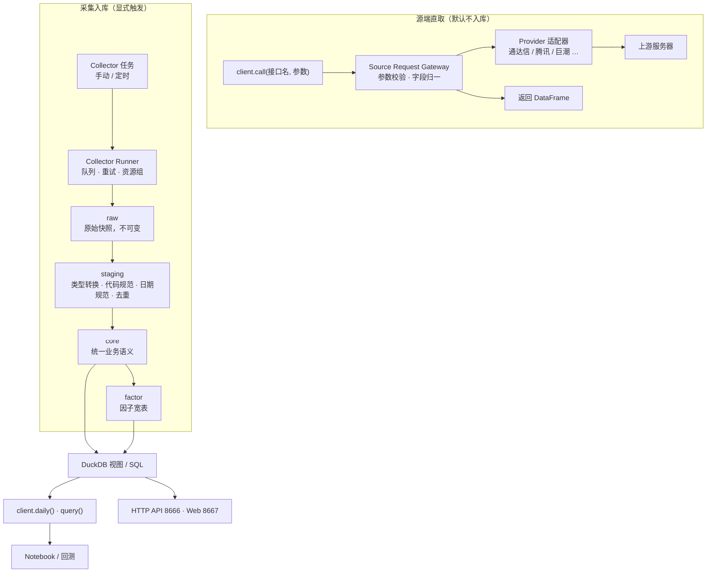

做 A 股量化，首先遇到的拦路虎就是从哪里获得数据。你可能已经尝试过 AkShare、Pytdx、Tushare、JQData、BaoStock、xtquant 等。一个无法回避的问题是：

免费的数据在获取时，常常会遇到**频率限制**、**品种限制**和**时长限制**。频率限制是指，服务器只允许你每分钟调用 API 多少次、获取多少条数据；品种限制是指，是否允许你获得某种关键数据，比如在常用的数据品种中，历史 ST 数据和历史涨跌停数据在某些数据源中就是需要付费或高积分的；时长限制则是指在你获取数据时，允许回溯的最大历史跨度。

此外，数据源本身也不是稳定可靠的。有的会因要推广自己家的 skill和量化平台套件而封杀网页爬虫，有的则因政策原因关闭。

解决这些问题的一个理想方案是：**把数据请求分散到多个数据源上，并启用标准化的本地存储。** 在启用本地存储之后，历史数据的请求直接从本地磁盘读取，无需反复访问远程服务器，这样不仅彻底解除了频率限制，也大大加快了回测速度；此外，你还可以通过外部导入或低频补采历史数据来突破时长限制；最后，使用多个数据源则可以集众家之所长，解锁品种限制。

AxData 正是朝着这个方向演进的量化数据解决方案。它还在积极开发中，4 个月前首次上线 GitHub，现在也才不到 1k 的 Star。坦率地说，它目前还不是一个装上就能自动拉满全市场十年历史数据的"成品数据库"，但由于它几乎是第一个把<b>"多源插件化接入 + 本地 Parquet/DuckDB 分层存储 + 统一 SDK/HTTP 供数"</b>用严谨工程架构跑通的开源方案，我们认为非常值得推荐。毕竟，开源项目能持续开发的唯一动力就是来自社区的关注与共建。


## /01 一图看懂 AxData的双轨制

从策略开发者的应用视角来看，最理想的数据调用体验其实应该只有一套统一的语义 API：用户只管声明“我要什么标的、什么时间段的数据”，由该 API 自己判断哪些数据可以直接从本地读取、哪些数据需要去远端服务器拉取并自动回填缓存。

可能是由于统一不同数据源方面的困难，AxData 只将极小一部分核心数据纳入本地存储，定时采集，使用时从本地读取；多数数据暂时还是走的从远端服务器直取的方式。所以，AxData 目前在数据方面实行的是双轨制。




如上图所示，AxData 提供了极佳的工程秩序：


- **左路（采集入库）**：只有显式通过 Collector 任务（手动或交易日定时触发）拉取的数据，才会经过队列限流、质量检查（Quality Check），按 `raw -> staging -> core -> factor` 四层模型落盘为开放的 **Parquet** 文件，并由 **DuckDB** 提供极速的本地 SQL 与视图查询。
-  **右路（源端直取）**：当你调用 `client.call()` 或 `POST /v1/request/*` 时，系统通过网关校验参数、请求上游并将字段归一化后直接返回，**默认不写盘**，适合盘中盯盘、接口调试或临时取数。
- **本地与局域网无缝切换**：Python SDK 在本机默认直读 Parquet/DuckDB，无需启动后台服务；而在局域网内只需启动 HTTP API（`8666` 端口），团队其他机器传入 `api_base` 就能用完全相同的代码远程取数，Web 控制台（`8667` 端口）则负责可视化管理任务、插件与数据质量。


## /02 数据全景：9 大数据源、257 个品种

如果只看本地核心表，你可能会低估 AxData 的覆盖面。事实上，在"源端直取"层，AxData 已经通过预装插件接入了 **9 大类数据源、共计 257 个数据接口**，不仅覆盖了 A 股传统量价与基本面，还延伸到了期货、期权、可转债以及 A 股极具特色的"短线打板/题材情绪"数据。

我们将其按数据源整理如下（具体 API 名称可直接在项目文档站检索）：

| 数据源                      | 涵盖的核心数据品种                                                                                                                                                                                                                                                                                         | 量化实战作用与使用限制说明                                                                                                                                                                      |
| :-------------------------- | :--------------------------------------------------------------------------------------------------------------------------------------------------------------------------------------------------------------------------------------------------------------------------------------------------------- | :---------------------------------------------------------------------------------------------------------------------------------------------------------------------------------------------- |
| **通达信** <br>(91)         | **股票/ETF/指数**的基础列表、涨跌停价、盘前股本、ST/停牌列表；日/周/月/分钟/秒级 K 线、复权因子；当日与历史分时、逐笔成交、集合竞价明细；五档盘口、实时快照与增量流；F10 财务、筹码分布、主力控盘、连板天梯与题材强度。                                                                                    | **A 股量价与短线主力源**。底层基于 7709 协议 Actor 连接池（支持多服务器自动补位与 WebSocket 实时流推送）。目前唯一默认内置 8 个独立定时采集器的数据源。                                         |
| **新浪财经** <br>(60)       | **期权**（中金所股指期权、上交所期权行情与 Greeks、商品期权）、**期货**（主力连续、日/分钟线、持仓排名、实现波动率）、**债券与可转债**（中美债收益率、转债概况）、**基金/ETF**（规模、分红）、A 股三大财务报表 JSON、龙虎榜席位追踪、限售解禁、ESG 评分、港美股及全球指数、中行外汇牌价。                  | **衍生品与跨市场宝库**。补齐了免费源极缺的期权 Greeks、商品/股指期货分钟线与结构化财务报表；属于公开 HTTP 接口，目前默认仅支持源端直取（`source_request-only`），高频调用需注意网页端反爬限流。 |
| **巨潮资讯** <br>(32)       | **上市公司公告**（公告列表、PDF 元信息、预约披露、调研公告）、**互动易**（投资者提问与董秘回答详情）、**公司治理**（股权质押、对外担保、公司诉讼）、**股本股东**（高管增减持、股东人数及集中度、实控人变动、配股方案）、**债券/可转债发行与转股**、基金重仓与资产配置、新股 IPO 与过会、行业分类与市盈率。 | **基本面、事件驱动与另类数据源**。官方信披口径，非常适合做事件驱动策略（如股东人数骤降、高管增持、调研文本 NLP 分析）；公告 PDF 仅返回元信息与下载链接，默认不入库。                            |
| **通达信扩展行情** <br>(31) | **期货**（合约列表、K 线、分时、当日/历史逐笔、实时快照）、**期权**（合约列表、T 型报价链、K 线、分时）、**债券**、**基金**（净值与走势）、**外汇**（K 线、分时、逐笔）、**宏观指标**（列表、快照与序列）。                                                                                                | **多资产高频与历史补充**。独立于普通通达信插件（`axdata-source-tdx-ext`），提供长达 55 个字段的期权 T 型报价与期货/外汇逐笔明细；需连接支持扩展行情的 TDX 服务器。                              |
| **东方财富** <br>(13)       | A 股与大盘指数实时快照、**行业/概念板块**（板块实时行情、板块成分股、个股所属板块）、**短线池**（涨停池、跌停池、昨日涨停今日表现、盘口异动明细）、**龙虎榜每日汇总**、**融资融券明细**、个股研报列表。                                                                                                    | **板块映射与盘面异动利器**。板块成分与盘口异动（如大笔买入、封涨停板）分类极细；属于公开 HTTP 接口，默认不提供定时采集器，需防高频请求封 IP。                                                   |
| **财联社** <br>(12)         | 电报快讯、**市场情绪**、今日主线机会、今日风口板块及龙头股、板块热度排行、板块轮动、含涨停原因的涨停池、个股分时与 K 线。                                                                                                                                                                                  | **题材风口与文本情绪源**。涨停池直接附带经过编辑提炼的"涨停原因"，极其适合短线题材挖掘与舆情监控；多为当日实时截面数据，缺乏长历史回溯。                                                        |
| **开盘红** <br>(9)          | **历史涨停/跌停股**、历史涨停复盘、**历史板块成分股**、历史风向标、涨停天梯、市场情绪、板块排行、盘面梳理事件。                                                                                                                                                                                            | **稀缺的短线历史复盘源**。弥补了普通免费源"只有当日热点、没有历史板块成分和历史涨跌停复盘"的短板，非常适合回测打板与接力策略。                                                                  |
| **腾讯财经** <br>(6)        | A 股历史日线、指数历史日线、历史起始年份查询、A 股实时行情列表、实时快照、A 股逐笔成交。                                                                                                                                                                                                                   | **轻量稳定的备用行情源**。HTTP 响应快、结构简单，适合轻量级实时快照轮询或与通达信日线做交叉校验；默认仅源端直取，不自动替代通达信入库。                                                         |
| **交易所** <br>(3)          | **交易日历**（上交所/深交所/北交所）、**股票基础信息**（官方上市状态、行业、总股本/流通股本、VIE/盈利标记）、**历史股票列表**。                                                                                                                                                                            | **系统级权威主数据**。其中 `trade_cal` 已产品化为系统基础数据缓存，所有日频行情采集任务运行前均依赖它做交易日对齐与缺口检查。                                                                   |


## /03 极度克制的 Core 层

看完了丰富的源端接口，我们回到最核心的"本地回测存储"。

首先问一个问题，对量化人来说，**一个最小的数据集必须包括哪些数据品种？** 看上去，答案取决于策略，因为不同的策略，需要的数据往往不同。
一个**最小的量化回测数据子集**，必须同时包含以下 6 类数据：

1. **日历**（确定开市日，驱动时间轴）
2. **证券列表**（含上市/退市日期，消除幸存者偏差）
3. **每日 OHLC、Volume、Amount**（基础量价事实）
4. **每日复权因子**（动态计算前/后复权价）
5. **每日涨跌停限价**（判断涨停能否买进、跌停能否卖出）
6. **每日 ST 列表**（决定 5% 还是 10%/20% 限幅及标的过滤）

不过，AxData 的 Core 层目前还没有完整提供所有这些数据品种。它的 `core`（核心事实表）层目前只定义了前 4 张表：`trade_cal`（交易日历）、`stock_basic_exchange`（股票列表）、`daily`（未复权日线）和 `adj_factor`（复权因子）。单看 `core` 层，它确实还没完全覆盖最小回测子集，而且默认任务只抓了 `000001.SZ` 的小样本，没有开箱即用的全市场历史库。

这么做的原因有两点。AxData 的作者认为，通过通达信获取的st列表只是当前的快照，而不是 PIT 数据，在解决这个问题前，没法写入 core 层。

- `tdx.stock_daily_price_limit_tdx.snapshot`（每日涨跌停价格）
- `tdx.stock_st_list_tdx.snapshot`（ST 股票列表）
- `tdx.stock_suspensions_tdx.snapshot`（停复牌列表）
- `tdx.stock_daily_share_tdx.snapshot`（每日盘前股本）

通过这些快照进行积累，假以时日，也可以补全这部分数据。但更快的方法，是对 AxData 进行一些拓展，把其它数据源的数据接入进来。比如，历史 ST 列表数据可以通过 baostock 获取。这里，我们以通过 tushare 获取历史涨跌停数据为例，介绍下如何拓展 AxData。


## /04 实战指南：如何拓展 AxData？

理解了 AxData 的架构边界后，你会发现它本质上是一个<b>"已经帮你造好了任务调度器、并发资源池、Parquet 写入器（Writer）、数据质量检查器（Quality）和 DuckDB 查询引擎"的量化数据底座</b>。

如果你想把前面提到的**每日涨跌停限价**、**历史 ST 列表**、**全市场日线**，或者是**开盘红的历史涨跌停、新浪的财报**真正沉淀到本地 `core` 层，形成一套完整的自有回测数据库，只需要按照 AxData 的插件规范做两步拓展：

### 1. 编写一个独立的 Collector（采集器）插件

在 AxData 中，数据源接口（Provider）和采集器（Collector）是解耦的。要让数据定时入库，你需要新建一个轻量 Python 插件包（在 `pyproject.toml` 中声明 `axdata.plugins` 入口点，并包含 `axdata-plugin.json` 清单文件）。在清单的 `collectors` 列表中声明一个 `CollectorSpec`（其中 `collector_plugin_id` 需与清单顶层的 `plugin.plugin_id` 一致）：

- **声明写入契约（`output`）**：把目标层级从默认的 `snapshot` 改为 `"layer": "core"`，并把写入模式声明为增量去重更新。表名由 `CollectorSpec` 的 `dataset_id` 指定，落盘路径则由 `output` 里的 `default_output_path_parts` 指定：

  ```json
  {
    "name": "my_plugin.daily_limit.core",
    "display_name_zh": "每日涨跌停价格采集",
    "collector_plugin_id": "my_plugin.core_collectors",
    "dataset_id": "daily_price_limit",
    "resource_group": "tushare.http",
    "runner_entry": "my_axdata_core_collectors.runner:run",
    "output": {
      "layer": "core",
      "formats": ["parquet"],
      "default_output_path_parts": ["core", "table=daily_price_limit"],
      "write_mode": "upsert_by_key",
      "primary_key": ["ts_code", "trade_date"],
      "partition_by": ["trade_date"],
      "date_field": "trade_date"
    },
    "quality": {
      "required_columns": ["ts_code", "trade_date"],
      "primary_key": ["ts_code", "trade_date"]
    }
  }
  ```

  其中 `default_output_path_parts` 建议显式写出，别依赖默认值。这里有一个极易踩坑的细节：写入器省略该项时取扁平的 `[layer, default_dir_name]`，而读取器在表名不含点号时期待 `core/table=<表名>` 布局。两边默认值不一致，会导致文件虽然落盘了，但读不回来——`data_browser` 报 `Dataset was not found`，`client.query` 报 `Core table parquet does not exist`：

  | 配置                             | 实际落盘                        | 读取器查找                      |
  | -------------------------------- | ------------------------------- | ------------------------------- |
  | 省略 `default_output_path_parts` | `core/daily_price_limit/`       | `core/table=daily_price_limit/` |
  | 显式声明                         | `core/table=daily_price_limit/` | `core/table=daily_price_limit/` |

  AxData 的 `DownloadWriter` 原生支持 `snapshot`、`append`、`overwrite_partition`（按分区覆盖）、`replace_range`（按日期闭区间替换补采）和 `upsert_by_key`（按主键合并去重）五种模式。配合 `partition_by: ["trade_date"]` + `date_field: "trade_date"` 时，parquet 分区会被压成扁平文件 `YYYYMMDD.parquet`，重跑同一天会按主键自动去重并只替换当天文件，历史分区不动。

- **声明依赖与质量检查（`required_datasets` 与 `quality`）**：加上 `"required_datasets": ["trade_cal"]` 可以让调度器在运行前校验交易日历依赖——但要注意，它读的是 `data/cache/exchange/trade_calendar/trade_calendar.parquet` 这个**日历缓存**，而不是写进 `core` 层的 `trade_cal` 表。

  质量检查则要理解得更准确一些：`quality` 是独立采集器的**必填项**（缺失会直接报 `requires quality` 导致整个插件注册失败），但它的校验时机是**写盘之后**。非负数值列、主键唯一性、`calendar_check` 都会给出 `quality_status`（`ok`/`warn`/`error`）并把该次运行标记为 `quality_failed`，却**不会回滚已经写入的分区**。换句话说，它是一道事后审计与告警，不是写前拦截。真想拦住坏数据，得在 `runner_entry` 里自己先做校验，或者事后用 `quality_status` 触发回补。

### 2. 实现 `runner_entry` 清洗逻辑并注册定时任务

在插件包里实现运行入口，只做「取数 + 标准化」两件事，把落盘交给 AxData（注意返回值的键是 `meta` 而不是 `metadata`，写错了不会报错，只会静默丢掉元数据）：

```python
def run(*, params=None, fields=None, collector=None, data_root=None,
        output_root=None, output_dir=None, formats=None, progress_callback=None, **_):
    # 1. 拉取全市场或指定日期范围的上游数据（如涨跌停限价、历史 ST 或全量日线）
    # 2. 执行 staging 标准化：统一代码后缀（.SH/.SZ/.BJ）、对齐 YYYYMMDD 日期、转换手/千元单位
    return {
        "records": cleaned_rows,
        "meta": {"source": "custom_core_pipeline", "data_date": trade_date},
    }
```

`runner_entry` 的实际调用约定是 `module:function`，AxData 会按参数名过滤后传入 `params`、`fields`、`collector`、`data_root`、`output_root`、`output_dir`、`formats`、`progress_callback` 以及若干执行选项——签名里写 `**_` 兜住即可，不存在 `context` 这个参数。

写好后，即可安装启用插件（外部插件安装后默认为 `disabled`，需显式 `enable` 才会进入采集器注册表），并注册定时任务（或打包成 `.axp` 插件信封分享给团队）：

```powershell
# 1. 安装并启用自定义采集器插件
.\.venv\Scripts\python -m pip install -e .\my-axdata-core-collectors
.\.venv\Scripts\axdata plugin enable my_plugin.core_collectors

# 2. 注册为每个交易日盘后 18:30 自动运行的常驻任务
.\.venv\Scripts\axdata collector task add my_plugin.daily_limit.core `
  --task-id core_limit_daily `
  --trigger-type daily `
  --daily-time 18:30 `
  --formats parquet

# 3. 手动触发一次运行并等待完成
.\.venv\Scripts\axdata collector task run core_limit_daily --wait
```

一旦跑通，数据就会以 `upsert_by_key` 落到 `data/core/table=daily_price_limit/parquet/YYYYMMDD.parquet`，并且 `axdata data list` 能直接发现它。

需要留意的是，**`client.query("daily_price_limit")` 并不会因此就能用**：`client.query` 走的是 `axdata_core.schema` 里硬编码的四张表（`stock_basic_exchange`、`trade_cal`、`daily`、`adj_factor`），传入未注册的表名会抛 `KeyError: Unknown AxData table`。要用 `client.query`，得先把这张表补进 `axdata_core.schema.SCHEMAS`；不想动源码的话，直接读文件更省事：

```python
from axdata_core import data_browser

summary = data_browser.get_dataset("daily_price_limit", data_root="data")
# summary.output_paths["parquet"] -> .../core/table=daily_price_limit/parquet
# 交给 DuckDB：read_parquet(f"{path}/**/*.parquet", hive_partitioning = false, union_by_name = true)
```

注意这里用 `hive_partitioning = false`：`table=` 只是目录命名约定，`trade_date` 的分区已经被 `DownloadWriter` 压平进 `YYYYMMDD.parquet` 文件，数据列里并没有 `table` 这一列。开成 `true` 会让 DuckDB 凭空多造一个 `table` 伪列。

## 写在最后

如果你期望的是一个装上就能直接白嫖全市场十年清洗好数据的"成品黑盒"，现阶段的 AxData 可能会让你觉得"怎么还要自己配任务、写扩展"；但如果你已经受够了各个免费接口各自为政的字段命名、脆弱的网络连接和杂乱无章的本地 CSV 文件，你会发现 AxData 已经把最枯燥的 **9 大源 257 个接口解析、Parquet 四层存储、DuckDB 引擎、单机任务调度与数据质量校验** 全部封装妥当。

它目前最缺的，正是社区开发者们基于这套标准底座，把全市场 `core` 层转换管道与更多数据源的 Collector 插件一块块拼齐。如果你也在做 A 股量化，不妨去 GitHub 试试它（[AxData 文档站](https://electkismet.github.io/AxData/index.html)），点个 Star，或者贡献你的第一个 `.axp` 采集插件。

